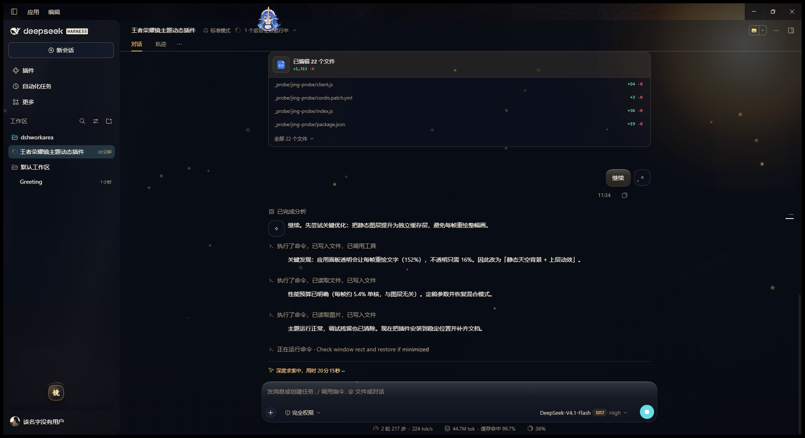

# 镜 · 炽阳神光 — DSH 主题插件

王者荣耀「镜 · 炽阳神光」主题：碎裂镜面 + 炽阳金辉的动态界面外观，为 DeepSeek Harness 的 Web / 桌面图形界面提供一整套金曜配色与全屏动态背景。



- 仓库：<https://github.com/AAAjzx111/dsh-theme-jing-chiyang>
- npm：<https://www.npmjs.com/package/dsh-theme-jing-chiyang>
- 发行版：<https://github.com/AAAjzx111/dsh-theme-jing-chiyang/releases>

自 1.1.0 起，主题里嵌入了「镜 · 炽阳神光」的主视觉：它同时作为整窗底图与两个主面板的肌理，
并按遮挡关系重绘在面板下方，文字始终压在稳定的暗色通道上。


## 这是什么

一个标准的 DSH **bundle 插件**（Host 半区 + Client 半区）：

- **Host 半区**（`index.js`）不做任何事，只提供 Loader 行需要的包入口，因此主题不会影响宿主逻辑。
- **Client 半区**（`client.js`）在页面里完成全部工作：
  - 覆写 DSH 自己的设计令牌（`--dsw-alias-*` 等，混合模式与深色模式各写一份），让侧边栏、气泡、输入框、菜单、代码块、滚动条、按钮等全部落到「墨蓝 + 熔金」的配色上；
  - 在界面**后面**画一张静态的夜穹：墨色天幕、炽阳日轮、金芒光冕、斜射光柱、磨砂镜片、从太阳散出的镜面裂纹、可读性薄雾与暗角；
  - 在界面**上面**叠一层会动的光：太阳的呼吸、金烬与镜尘、约 19 秒一次的掠光、跟随鼠标的神光光晕；
  - 左下角一枚「镜」字徽记，点一下即可在 **神光（全动效）→ 静谧（缓慢）→ 关闭** 三档之间切换，选择记在浏览器 `localStorage` 里。

## 为什么这样分层

这台机器是软件渲染（没有 GPU 加速）：任何持续变化的图层都会让整窗重绘。实测（同一时刻开关主题对比）：

| 做法 | 单核占用 |
|---|---|
| CSS 动画 + 整窗 canvas 粒子 | 约 140–160% |
| 面板透明 + 背景层随帧变化 | 约 150%（文字被反复重绘） |
| **静态背景 + 上层动效 + 8 fps 时钟** | **约 40%（可再切静谧/关闭）** |

所以最终形态是：背景一动不动（只画一次），只有上层的少量元素在动，并且由一个 8 fps 的时钟统一驱动；标签页隐藏或窗口失焦时自动停表。

## 安装

### 从 npm（推荐）

```powershell
dsh plugin --profile desktop add dsh-theme-jing-chiyang
```

Web 版把 `desktop` 换成 `web`。

### 从 GitHub

```powershell
dsh plugin --profile desktop add github:AAAjzx111/dsh-theme-jing-chiyang
```

### 离线压缩包（发给不想碰命令行的人）

把发行版里的 zip 解压，在解压目录执行：

```powershell
powershell -NoProfile -ExecutionPolicy Bypass -File .\install.ps1
```

脚本会复制插件到 `%USERPROFILE%\.dsh\profiles\<profile>\plugins\`、在 `node_modules` 建链接、
往 `cordis.patch.yml` 补一行挂载（先备份）。卸载：同一条命令加 `-Uninstall`。

三种方式装完都要**完全退出 DSH 再打开**（只关窗口不够），主题才会挂上。

## 卸载

从 `cordis.patch.yml` 去掉上面那三行，再删掉 `node_modules\dsh-theme-jing-chiyang` 链接与 `plugins\dsh-theme-jing-chiyang` 目录。

主题的清理是完整的：卸载时三张样式表、背景层、动效层、徽记、事件监听与动画时钟都会一并移除，界面回到 DSH 原始外观。

## 目录

```
dsh-theme-jing-chiyang/
├── package.json          # 清单：dsh.bundle.patch + dsh.client（platform: web）
├── cordis.patch.yml      # 把插件插入 profile 配置树
├── index.js              # Host 半区（空实现）
├── client.js             # Client 半区：令牌 + 静态背景 + 动效层 + 徽记
├── skin.json             # 主题身份（供插件市场归类为 theme）
├── locale/{en,zh}.json   # 插件列表里的标题与描述
├── icon.svg              # 金色镜片徽记
└── README.md
```

## 主视觉（1.1.0）

`assets/key-art.webp` 是内联进 `client.js` 的（base64 data URI），因此主题不需要额外请求、离线可用。
想换图：替换 `assets/key-art.webp` 后重新生成 data URI（`client.js` 顶部的 `const KEY_ART`），
再刷新页面即可。当前是 1600px 宽、WebP q72，约 120 KB，内联后约 160 KB。

## 可调项

`client.js` 顶部：

```js
const FPS = { full: 8, calm: 2, off: 0 }      // 时钟帧率
const SPEED = { full: 1, calm: 0.5, off: 0 }  // 动效速度倍率
```

帧率是性能与观感的唯一旋钮：`8` 在软件渲染下比较克制，有独显/硬件合成的机器可以调到 `20`–`30` 让光尘更顺滑。

配色集中在 `TOKENS_CSS`，日轮/光冕/镜片的位置与形状在 `STAGE_CSS` 与 `SHARDS` 里，粒子的数量与轨迹在 `buildEmbers()` 里。

## 已知限制

- 主题会**强制使用深色配色**（金色夜穹是深色画布），并在页面里保持 `data-ds-dark-theme`；设置里的浅色/深色开关对它不生效。
- 桌面壳的注入表在宿主启动时一次性收集，若插件是在宿主运行中被手工加进来的，这一版能热挂载生效；但若宿主重启后仍要显示，插件必须留在 profile 里（本仓库的安装步骤已经保证）。
- 面板保持半透明会让文字每帧与背景重新混合，软件渲染下代价明显；若机器吃力，用「静谧」或「关闭」。
- 主题不替换 DSH 的组件样式，只覆写设计令牌并叠加上下两层画布；DSH 升级后若令牌改名，个别控件可能回落到默认色。

## 许可

代码 MIT（见 `LICENSE`）。`icon.svg` 为随本插件一起使用而绘制，与代码同许可。
